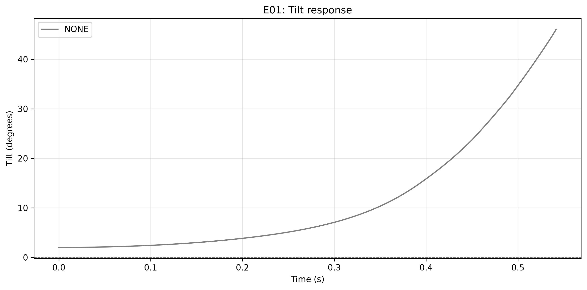
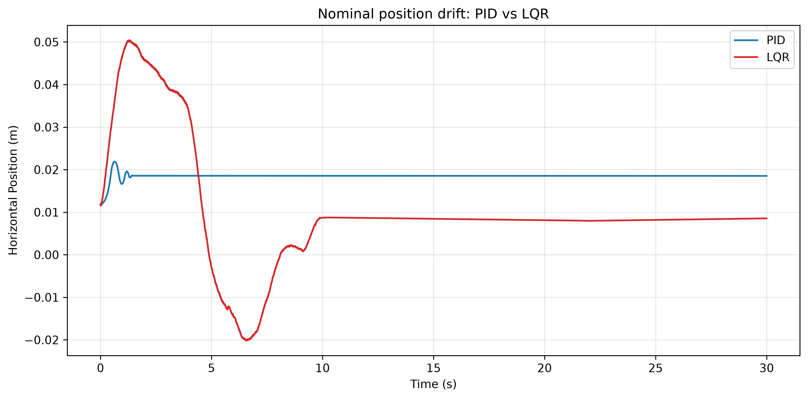
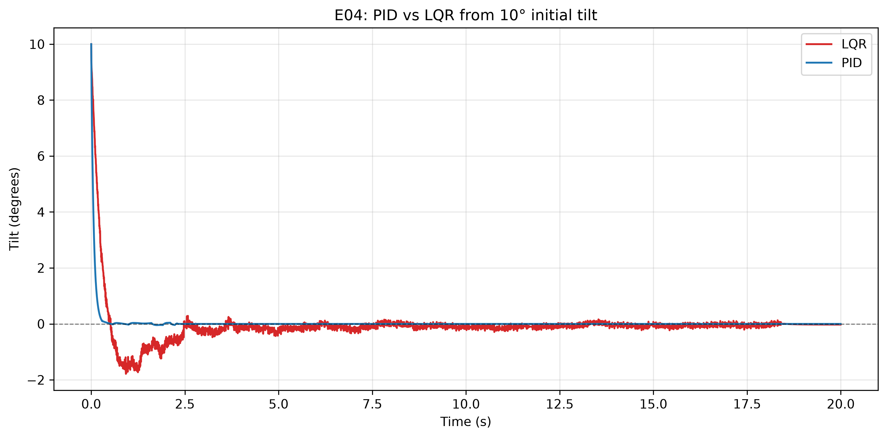
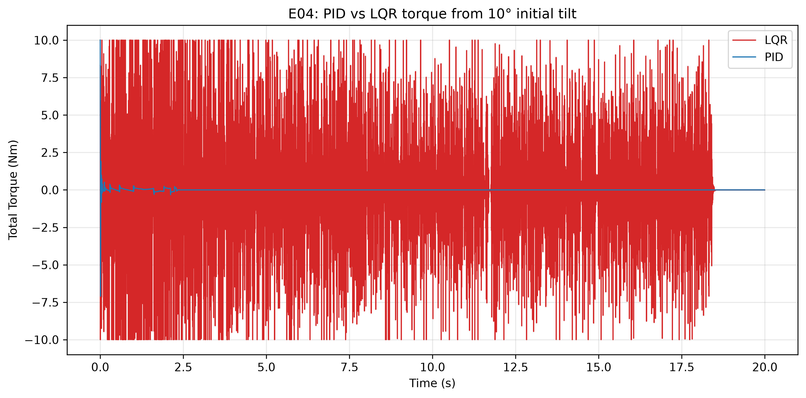
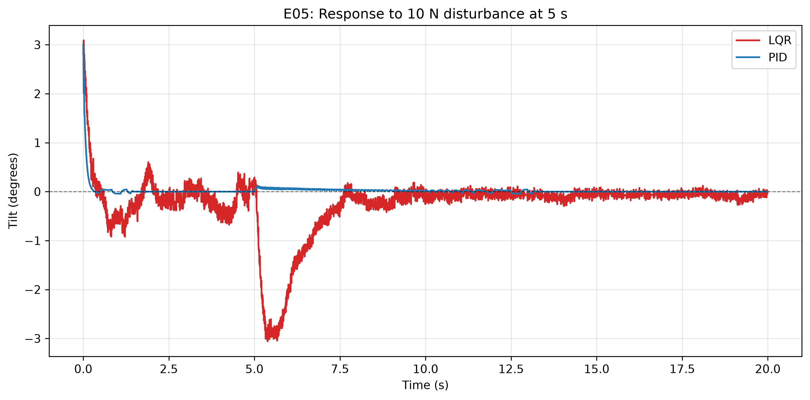
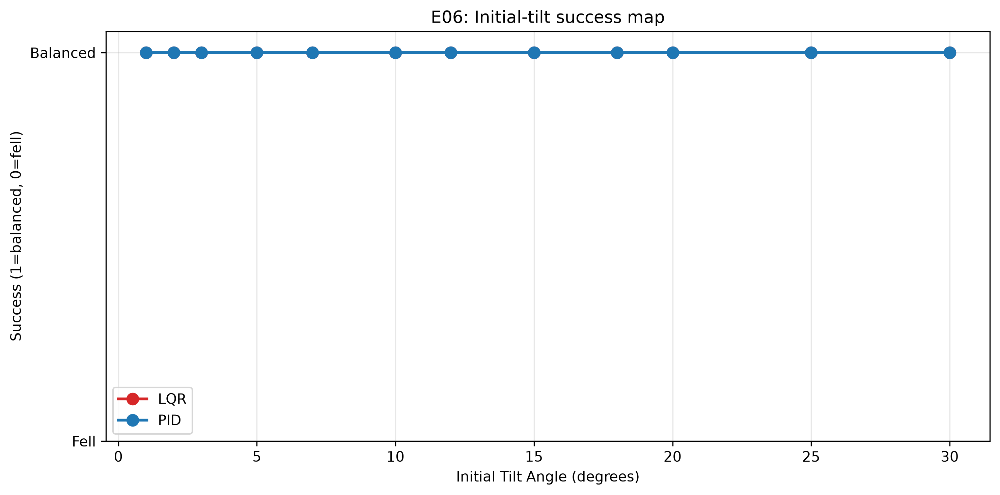

# Self-Balancing Two-Wheel Robot Using PyBullet

**Course:** CSAI4014 – Algorithms for Intelligent Systems and Robotics  
**Programme:** B.Tech CSE (AI & ML), Semester VII  
**Group:** [GROUP_NO]  
**Submission date:** [SUBMISSION_DATE]  
**Repository:** https://github.com/saiuppalapati011/self-balancing-two-wheel-robot

> **Draft status.** This is the evidence-based Phase 3 report draft. Replace the front-matter
> placeholders, complete the syllabus mapping from the course handout, and verify the references
> marked `[VERIFY]` in `docs/literature_review.md` before submission. All reported experiment
> values are generated from the saved CSVs by `scripts/generate_phase3_assets.py`.

## Abstract

This project develops and evaluates a simulated self-balancing two-wheel robot as an inverted
pendulum in PyBullet. A URDF robot, a Lagrangian-derived four-state linear model, a tilt-based PID
controller, and a full-state linear quadratic regulator (LQR) are implemented in Python. The
simulation runs at 240 Hz and records controller, state, wheel, and disturbance data to CSV. Six
experiments evaluate uncontrolled falling, nominal balancing, controller comparison, disturbance
response, and recovery from initial tilts between 1° and 30°. The uncontrolled robot falls from a
2° tilt after 0.542 s. Both controllers remain upright for the 30 s nominal test and meet the
strict ±0.5° settling definition. PID achieves lower nominal RMS tilt error (0.001685 rad) and
settles in 0.117 s, while LQR has lower final position displacement (0.0085 m versus 0.0185 m).
In the tilt sweep, both controllers succeed at every tested tilt through 30°; their upper
robustness limits were therefore not measured. The results show a tilt-regulation versus
position-containment trade-off for the selected designs rather than a universal winner.

## 1. Introduction

A two-wheel balancing robot has its centre of mass above its wheel axle, making the upright state
an unstable equilibrium. Without active wheel torque, even a small tilt grows until the chassis
falls. This makes the platform a useful, compact example of feedback control, nonlinear dynamics,
and simulation-based validation [1], [3], [7].

The objectives were to: (1) construct a physically parameterised PyBullet robot; (2) derive and
validate a linearised state-space model; (3) implement PID and LQR controllers with a common
torque interface; (4) collect reproducible evidence under matched conditions; and (5) quantify
controller trade-offs rather than relying on a single demonstration run.

The work is limited to straight-line pitch-plane balancing. It does not model steering, yaw
control, motor electrical dynamics, sensor bias, battery constraints, or real-hardware effects.

## 2. Literature Review

The inverted pendulum is a standard example of an under-actuated, unstable system in feedback and
state-space control [1], [2], [7]. Grasser *et al.* demonstrated a two-wheeled mobile inverted
pendulum whose geometry and control challenge closely resemble this project [3].

PID remains a practical feedback controller because its proportional, integral, and derivative
terms can be tuned intuitively. Derivative-on-measurement and anti-windup are used here to avoid
setpoint kick and unbounded integral growth [2], [6]. LQR instead selects full-state feedback by
minimising a quadratic state-and-effort cost, with the continuous algebraic Riccati equation solved
numerically [5], [8], [10]. PyBullet provides the rigid-body, contact, URDF, and torque-control
facilities used for the nonlinear simulation [4].

The project contribution is not a claim that PID or LQR is novel. It is a controlled comparison of
both approaches on the same robot, across disturbance and initial-condition tests, with saved raw
data and fixed metric definitions.

## 3. Problem Formulation

The robot consists of a 2.0 kg chassis above two 0.25 kg wheels. Each wheel has radius 0.08 m;
the chassis dimensions are 0.45 m × 0.20 m × 0.12 m. World +X is forward, +Z is upward, and a
positive pitch angle θ denotes a forward lean. The controller returns total wheel torque
`u = τ_L + τ_R`, which is split equally between the wheels.

The state vector is

`x_state = [x, x_dot, theta, theta_dot]^T`.

The control objective is to keep `|theta| < 45°` for the configured run duration, with upright
regulation and low position drift preferred. A fall is declared at 45°.

## 4. Mathematical Model

The model uses the Lagrangian of the chassis and two rolling wheels. The wheel rolling constraint
eliminates wheel angle, leaving horizontal position `x` and chassis pitch `theta` as generalized
coordinates. The detailed kinetic-energy, potential-energy, nonlinear-equation, and linearisation
derivation is retained in `docs/mathematical_model.md`.

Linearisation around the upright equilibrium gives the state-space model:

```text
A = [[0, 1,       0,    0],
     [0, 0, -19.694,    0],
     [0, 0,       0,    1],
     [0, 0, 120.351,    0]]

B = [[0], [18.132], [0], [-83.027]]
```

For the configured geometry, the chassis centre of mass is 0.225 m above the axle and the
effective pendulum inertia is approximately 0.1103 kg·m². The open-loop model has an unstable
real pole near +10.97 rad/s, confirming that the upright state requires feedback. The
controllability matrix has rank 4, so all four linear states are controllable.

The linear model is used to design LQR, while PyBullet supplies the nonlinear validation model.
Differences are expected because contact, wheel friction, finite torque, and large-angle motion are
not represented perfectly by the small-angle model.

## 5. Robot Design and Simulation Setup

The robot URDF defines a chassis, two continuous wheel joints, and a forward marker. Default
velocity motors are disabled before applying PyBullet torque control. Wheel friction is configured
as lateral 0.8, rolling 0.001, and spinning 0.001. The physics timestep and controller rate are
both 0.004167 s (approximately 240 Hz); gravity is -9.81 m/s².

The sensor module extracts tilt from the base quaternion by projecting the chassis up-axis into the
world XZ plane. Its default run configuration has no added noise or delay. The simulation records
time, tilt, angular rate, horizontal motion, wheel velocities, torque commands, applied torque,
disturbance force, and balancing/fall status.

## 6. Controller Design

### 6.1 PID controller

The tuned PID gains are `Kp = 130.0`, `Ki = 0.3`, and `Kd = 8.0`, with a 10 Nm total-torque
limit. The implemented error is `theta - theta_ref`; positive forward tilt therefore commands
positive wheel torque. The derivative is taken from the measured tilt rather than from error, and
the integral state is clamped to prevent windup. The derivative filter uses
`(1 - alpha) * previous + alpha * raw`, with `alpha = 0.7`.

### 6.2 LQR controller

LQR minimises `J = integral(x^T Q x + u^T R u) dt` using
`Q = diag(1, 1, 100, 10)` and `R = 0.1`. The resulting gain is approximately

`K = [-3.1623, -7.3231, -46.9007, -11.6784]`.

The controller applies `u = -K x_state`, then clips the command to ±10 Nm. The closed-loop
linear eigenvalues have negative real parts, but nonlinear PyBullet performance is assessed
separately rather than inferred from this property alone.

## 7. Experimental Methodology

All tests use the same URDF, timestep, controller rate, fall threshold, seed (42 except the
uncontrolled run label), and metric implementation. The fixed metrics include success/fall time,
maximum absolute tilt, ±0.5° settling time, steady-state absolute tilt error over the last five
seconds, RMS tilt error, torque use, and horizontal displacement. A reported `None` settling time
means the trajectory did not remain inside the ±0.5° band for the rest of the run.

| ID | Test | Conditions |
|---|---|---|
| E01 | Uncontrolled fall | 2° initial tilt, 5 s maximum |
| E02 | Nominal PID | 3° initial tilt, 30 s |
| E03 | Nominal LQR | 3° initial tilt, 30 s |
| E04 | Comparison | PID and LQR at 2°, 5°, 10°, and 15° |
| E05 | Disturbance | 10 N forward force for 0.1 s at t = 5 s |
| E06 | Tilt sweep | 1°–30°, 12 values, 15 s each |

All results tables are reproducible with:

```bash
/Users/saiuppalapati/miniforge3/bin/python3 scripts/generate_phase3_assets.py
```

## 8. Results and Discussion

### 8.1 E01: uncontrolled fall

From an initial 2° forward tilt, the robot crossed the 45° fall threshold at **0.541710 s**.
It received no wheel torque. This confirms the physical simulation exhibits the expected open-loop
instability.



### 8.2 E02 and E03: nominal balancing

Both controllers stayed upright for 30 s, but their performance differs materially.

| Controller | RMS tilt (rad) | SS absolute tilt (°) | Peak torque (Nm) | Final position (m) |
|---|---:|---:|---:|---:|
| PID | 0.001685 | 0.000434 | 9.337955 | 0.018531 |
| LQR | 0.003813 | 0.037638 | 10.000000 | 0.008544 |

PID has smaller tilt error and reaches the strict settling band sooner in this nominal run. LQR
uses the position states and has the lower final displacement (about 8.5 mm versus 18.5 mm), but
requires the full 10 Nm torque limit and settles more slowly. Both traces meet the strict ±0.5°
settling definition; their measured settling times are 0.117 s (PID) and 5.730 s (LQR).



### 8.3 E04: matched initial-tilt comparison

The complete results are in `results/tables/E04_comparison_table.csv`. Both controllers complete
every matched case through 15°. PID reaches the ±0.5° band sooner in the 15° case (0.225 s versus
5.180 s for LQR), while LQR has lower final displacement (0.041 m versus 0.236 m). The 10° overlay
below is a matched successful case.





### 8.4 E05: disturbance response

Both controllers remain below the 45° fall limit following the 10 N disturbance. PID reaches a
post-disturbance maximum tilt of 0.123062° and ends at 0.000922°, while LQR reaches 3.059538° and
ends at 0.006406°. LQR has much lower final displacement (0.015029 m versus 1.263479 m for PID).
Thus, within the chosen implementation, PID rejects this particular impulse better in tilt while
LQR provides stronger position containment. Both claims are limited to this one force magnitude,
direction, height, and duration.



### 8.5 E06: initial-tilt sweep

Both PID and LQR succeed at all twelve tested initial tilts through 30°. Accordingly, the measured
one-dimensional basin for each controller is **at least 30°**; the upper limit for neither
controller was tested. PID has lower RMS tilt across the sweep, whereas LQR generally has lower
final displacement at the larger tilts.



### 8.6 Interpretation

The experiments do not support a blanket claim that one controller is better on every metric. PID
has lower nominal RMS tilt, faster settling, and a smaller response to this single disturbance,
but it has greater position displacement. LQR provides stronger position containment but reaches
the torque limit and settles more slowly. Both remained upright at every tested initial tilt. The
appropriate conclusion is therefore metric- and task-dependent.

## 9. Contributions

1. **Matched controller comparison:** PID and LQR use the same robot, timing, torque limit,
   initial conditions, data schema, and metrics.
2. **Measured initial-condition robustness:** E06 verifies success across 24 controller/tilt
   combinations rather than showing a single demonstration.
3. **Disturbance evidence:** E05 records both tilt and position consequences of a defined external
   impulse.
4. **Traceable modelling path:** the Lagrangian derivation, state-space matrices, controller
   implementation, raw CSVs, generated tables, and figures are all retained in the repository.
5. **Reproducible workflow:** new runs write runtime and configuration provenance in JSON sidecars.

## 10. Testing and Validation

The test suite covers configuration loading, linear dynamics, PID, LQR, sensors, metrics, I/O,
plots, PyBullet imports, and slow integration balancing tests. The current validated result is
**50 passed** using miniforge Python 3.12.12 and the installed PyBullet build. E01 supplies an
additional physical validation: an uncontrolled tilted robot falls rather than remaining upright.

## 11. Limitations

- PyBullet contact and friction do not replace physical hardware validation.
- The LQR model is linearised around upright operation; its theoretical guarantees are local.
- The study is limited to pitch-plane motion and symmetric torque; yaw and steering are excluded.
- PID has no explicit position feedback, which can allow greater accumulated drift than the
  full-state LQR design.
- The LQR configuration was not exhaustively re-tuned against the nonlinear simulator; its
  torque-versus-settling trade-off should be investigated before making an optimality claim.
- Sensor noise, delay, motor saturation dynamics, battery effects, and uneven terrain are outside
  the primary experiments.

## 12. Conclusion and Future Work

The project delivers a tested PyBullet self-balancing robot, analytical model, PID controller,
LQR controller, six experiment protocols, reproducible result tables, and a public repository.
Both controllers succeeded through the largest tested 30° initial tilt, so a larger sweep is needed
to distinguish their robustness limits. PID produced lower tilt error and faster settling in the
nominal and tested disturbance runs, while LQR produced lower final position displacement.

Future work should add position-aware PID or cascaded control, tune LQR weights using a systematic
nonlinear simulation sweep, model sensor noise and motor dynamics, add steering/yaw control, and
validate the design on physical hardware.

## References

[1] K. J. Åström and R. M. Murray, *Feedback Systems: An Introduction for Scientists and
Engineers*. Princeton University Press, 2008.

[2] K. Ogata, *Modern Control Engineering*, 5th ed. Prentice Hall, 2010.

[3] F. Grasser, A. D'Arrigo, S. Colombi, and A. C. Rufer, “JOE: a mobile, inverted pendulum,”
*IEEE Transactions on Industrial Electronics*, vol. 49, no. 1, pp. 107–114, Feb. 2002.

[4] E. Coumans and Y. Bai, “PyBullet, a Python module for physics simulation for games, robotics
and machine learning,” http://pybullet.org, 2016–2021.

[5] B. D. O. Anderson and J. B. Moore, *Optimal Control: Linear Quadratic Methods*.
Prentice-Hall, 1990.

[6] K. J. Åström and T. Hägglund, *PID Controllers: Theory, Design and Tuning*, 2nd ed.
Instrument Society of America, 1995.

[7] G. F. Franklin, J. D. Powell, and A. Emami-Naeini, *Feedback Control of Dynamic Systems*,
8th ed. Pearson, 2019.

[8] R. E. Kalman, “Contributions to the theory of optimal control,” *Bol. Soc. Mat. Mexicana*,
vol. 5, pp. 102–119, 1960. **[VERIFY bibliographic details before submission]**

[9] **[REQUIRED BEFORE SUBMISSION]** Replace with a verified recent peer-reviewed paper on
two-wheeled self-balancing robot control.

[10] P. Virtanen *et al.*, “SciPy 1.0: Fundamental Algorithms for Scientific Computing in Python,”
*Nature Methods*, vol. 17, pp. 261–272, 2020. **[VERIFY DOI before submission]**
